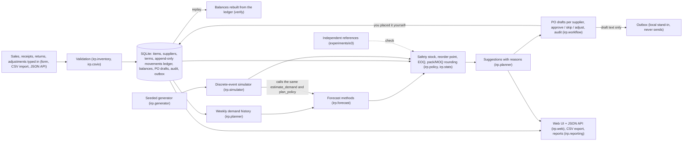

<p align="center"></p>

<p align="center">
  
  
  
</p>

# Inventory & Reorder Planner

> Know what to order, when and how much, and see why.

A local, single-tenant stock and reorder planner for small retailers and workshops. Every sale, receipt, return, write-off and adjustment goes into an append-only ledger, so on-hand, on-order and allocated quantities can always be rebuilt and checked. For each item the planner forecasts demand, combines it with the supplier's lead time and its variability, sets a safety stock and reorder point for the service level you choose, and lists what to order with the arithmetic shown. Suggestions become purchase-order drafts grouped by supplier, rounded to pack sizes and minimum order quantities, which a person approves, skips or adjusts with an audit trail. A web UI and a JSON API serve it. Python standard library only: no dependencies to install.

> **It plans and drafts. It never places an order, never emails or contacts a supplier, and never moves stock by itself.** "Placed" on a purchase order means *you* placed it elsewhere and told the tool. Forecasts, safety stocks and reorder points are statistical estimates from the sales you record, not guarantees; check the first suggestions against your own judgement.

**Quick links:** [Architecture](#architecture) · [Tech stack](#tech-stack) · [Engineering decisions](#engineering-decisions) · [Roadmap](#roadmap) · [Case study](docs/case-study.md) · [Research report](docs/research-report.md)

> **Public showcase.** This repository holds the documentation, client case study, research report and measured results for this product. The runnable source code is distributed separately under a license: see [SOURCE-ACCESS.md](SOURCE-ACCESS.md).

## At a glance

|  |  |
|---|---|
| **Track** | Business |
| **Phase** | Beta: all five milestones are built and tested and all four experiments have recorded results. It runs locally on synthetic data only; it is not deployed, has no authentication, cannot place orders or send email, has never held a real shop's stock, and the UI was rendered once in an automation browser during the build but has not been used by a person on other browsers, on a phone or with a screen reader, or audited for accessibility. It computes estimates from the data a user enters and gives no business, tax or accounting advice. |
| **Primary reader** | Clients and founders |
| **Read next** | [README](README.md) · [Client case study](docs/case-study.md) · [Research report](docs/research-report.md) |

## Why this exists

Small shops and workshops reorder from memory and from the shelf. Fast sellers run out because the supplier is slower than anyone remembers; slow sellers pile up; a bulk deal buys a year of stock. Minimum order quantities and pack sizes make the right quantity awkward, so people round up. Inventory suites solve this but bring per-seat pricing, data you do not control and modules you do not need. This is a small planner you can read, run on your own machine and change.

## What it does (all of this is built and tested)

- **Data model and inventory engine (M1).** Items, locations, suppliers and per-supplier terms (lead time **with its variability**, pack size, minimum order quantity, unit cost; one primary supplier per item) in SQLite. A **movements ledger** (receipt, sale, adjustment, return, write-off, order placed, order cancelled, allocate, release) that the database refuses to edit or delete. **On-hand, on-order and allocated** balances are kept incrementally, and `replay` rebuilds them from the ledger alone (also as of a past date) so a mismatch is detectable (`python -m irp verify`). Invariants are enforced on every write: nothing goes negative, allocations never exceed stock, movements for an item and location are in date order, corrections are new adjustments.
- **Demand and policy (M2).** Demand aggregation into weekly buckets; forecasting by **moving average, simple exponential smoothing, seasonal-naive and Croston** (with the Syntetos-Boylan correction) and a documented rule that picks a method from the demand pattern (smooth, erratic, intermittent, lumpy); **safety stock and reorder point** from service level, demand variability and lead-time variability using the normal approximation (`math.erf`, with a stdlib inverse normal), either for a **cycle service level** or a **fill-rate** target; **economic order quantity** rounded to pack size and minimum order quantity (cheapest of the two neighbouring pack multiples); **ABC and XYZ** classes; **dead-stock and overstock** flags.
- **Workflow and UI/API (M3).** **Reorder suggestions that show their reasons** (demand, lead time, safety stock, reorder point, inventory position, quantity), **purchase-order drafts grouped by supplier**, **approve, skip or adjust** per line with a reason, an **audit trail** the database refuses to edit, recording that you placed an order yourself, receipts against it, and a **local outbox** that holds draft emails and **never sends** (its status column can only say `queued`). Server-rendered local web UI (dashboard of items below their reorder point, item page with an inline-SVG sparkline and its data table, supplier pages, PO drafts, outbox, audit, import/export, settings, reports) and a JSON API for the same. **CSV import** with validation errors reported **per row** (row number, file line, field) and an all-or-nothing mode, and **CSV export** that defuses spreadsheet formulas. Semantic markup with landmarks, labelled controls and table captions; no accessibility conformance is claimed and none has been audited.
- **Reporting and simulator (M4).** Stock value (by category and location), turnover, holding-cost and stockout estimates (labelled as estimates), **forecast accuracy by method** on your own history (MAE, bias, WAPE and a scaled error), a **seeded synthetic demand generator** (smooth, seasonal, trending, intermittent, lumpy), a **synthetic small business** (items, suppliers, a year of trading replayed through the real ledger), and a **discrete-event inventory simulator that calls the product's own planning code**.
- **Experiments (M5).** E1 forecast accuracy across demand patterns (paired seeds, rolling origin, intervals, which method wins where); E2 reorder policies (s,Q), (s,S) and periodic review at 90, 95 and 99% service targets in the simulator, including whether the achieved fill rate matches the target; E3 calculators checked against independent references with 17 deliberately broken variants that must be caught; E4 UI/API throughput with machine load disclosed. Raw data and verdicts are in `results/`.

## Not built / out of scope

| Item | Why |
|---|---|
| Placing orders, emailing suppliers, EDI, supplier portals | By design the product plans and drafts only. The outbox is a **local stand-in**: it records the message that *would* be sent and cannot hold any other status. Sending is engagement work. |
| Point-of-sale, accounting and e-commerce integrations | Need accounts and credentials. Sales arrive by recording movements in the UI/API or by CSV import. |
| Authentication, roles, permissions | Single-tenant local demo bound to `127.0.0.1` with no login. "Acting as" a name is a cookie convenience that labels the audit trail, not a security control. Request hardening (form tokens, Host and Origin checks, JSON content type, CSP) is in place but has not been security reviewed. |
| Multi-tenant isolation, hosted deployment, containers, queues, PostgreSQL | One SQLite file and one process; every request runs under one global lock. No container was built. |
| Replenishment planning per location | Planning works per item across all locations (stock is totalled); a PO drafts into one receiving location. Per-location targets and transfers between locations are not built. |
| Backorders, stockout-corrected demand | Demand is **recorded sales**. A stockout hides demand (the experiments let the simulator's planner see only sales, as a real shop would), and returns are not netted off. Unmet demand is not a ledger concept. |
| Trend and Holt-Winters methods, automatic method selection by accuracy, forecast of new items, promotions | Not started. The four methods above plus a naive benchmark are what exist; the `auto` rule is a documented heuristic, not an optimiser. |
| Supplier price breaks, minimum spend, multiple prices, currencies, tax | One unit cost per item and supplier, one currency label, no tax. |
| Bills of materials and assemblies, lots, serial numbers, expiry, barcode scanning, cycle-count workflow, valuation methods (FIFO, average cost) | Not started. Stock value is on-hand units times the item's current unit cost. |
| Seasonal-naive on short histories | Needs 52 weekly periods; with less it falls back to exponential smoothing and says so. Seasonal-naive is also skipped in the accuracy report for items without more than 52 weeks. |
| Editors in the UI for suppliers, items' supplier terms and locations | Available through CSV import or the JSON/Python API; the UI edits only an item's service level and forecast method, and the global settings. |
| Printing or PDF export of purchase orders | Not started: a draft is on screen, in the API, and as plain text in the outbox. |
| Accessibility audit, screen-reader and cross-browser testing, mobile layout testing | Not done. No conformance claim of any kind is made. |
| Real-data validation | No real shop's data exists here; every experiment uses generated or simulated data. Results describe the generator and the simulator, not any real business. |

## Architecture



## Tech stack

| Layer | Technology actually used |
|---|---|
| Language, tooling | Python 3.12 (standard library only), `uv` to pick the interpreter, `unittest` |
| Persistence | SQLite via stdlib `sqlite3` (one connection behind a lock, foreign keys on, WAL for file databases, triggers that make the ledger and audit trail append-only) |
| Maths | `math` (`erf`, `erfc`), `random` (seeded generators), `heapq` (simulator events); inverse normal and loss function written in `irp.stats` |
| Web | `http.server` (`ThreadingHTTPServer`), server-rendered HTML with `html.escape`, one small CSS file served locally, no JavaScript, no external assets, inline SVG sparkline |
| Reporting and experiments | Plain Python statistics (percentile bootstrap, sign-flip permutation test, Holm correction, rolling-origin evaluation, Monte Carlo and exact enumeration references) |
| Notifications | Local outbox table (stand-in; nothing is sent) |
| CI | GitHub Actions workflow file `.github/workflows/ci.yml` (written to run the same commands as below; **never run**, because nothing was published) |

## Engineering decisions

### One definition of what a ledger row does

`irp.inventory.effects(kind, qty, applies)` is the only place that says how a movement changes on-hand, on-order and allocated. The incremental balance update, the replay, the on-hand time series and the checks all use it, so they cannot drift apart. Stored balances exist for speed; `verify` compares them with a replay and `rebuild_balances` repairs them. Triggers make the movements and audit tables append-only, so corrections are new rows.

### The reorder point is built from stated assumptions and shows its work

The formulas are written at the top of `irp/policy.py`: demand per day with mean and standard deviation, a random lead time with its own mean and standard deviation, independent of demand; lead-time demand has variance `L*sigma^2 + mu^2*sigma_L^2`; safety stock is `z * sigma_LT` for a cycle service level, or solves the normal loss equation for a fill-rate target. Every suggestion renders its numbers in plain sentences, and the item page lists the same figures. The variability input is the root-mean-square one-step forecast error, so a poor forecast raises safety stock instead of hiding.

### The simulator runs the production code, not a copy

`irp.planner.estimate_demand` and `irp.policy.plan_policy` are called by both the item page and the simulator, and the order rules (`order_qty_sq`, `order_qty_ss`, `order_qty_periodic`) are shared too. The simulator's planner sees *sales*, not true demand, so stockouts censor its history exactly as they would in a shop. Tests prove the simulator calls the real functions and that breaking them changes the result.

### Experiments can fail, and are shown to be able to

E3's check suite runs against a "subject" bundle of callables. The same suite is run against 17 deliberately broken subjects (wrong tail, missing factor 2, rounding down, swapped smoothing constant, ...) and must fail on each. A check that cannot fail is not evidence. Where a first small run showed that the normal approximation is not exact under a random lead time, the tolerance was split into a strict fixed-lead-time check and a loose, stated random-lead-time check, and the change is in the research report's change log.

### The importer refuses to guess

Dates must be `YYYY-MM-DD`, amounts plain decimals with at most two places, quantities whole numbers, kinds from a fixed list, field counts exact, over-long text rejected rather than truncated, an unbalanced quote fails the whole file. Every problem is reported with data-row number, file line and field. Valid rows import and invalid rows are reported, or with "all or nothing" nothing imports. Export defuses cells that start with `=`, `+`, `-` or `@`.

### Nothing leaves the machine

The server refuses to bind anything but a loopback address and checks Host and Origin headers. The outbox's status column is constrained to `queued`. A test scans the product's source for imports of mail, socket, HTTP-client and process modules. Seed data uses reserved `.example` domains; experiments that start a server do so on `127.0.0.1` with a temporary database.

## Quality bar

- Ledger, replay (including as-of replay and detection of an impossible ledger), validation of every field, nested-transaction rollback and persistence in a file database have tests; the same suites check that failed writes leave nothing behind.
- Forecast methods are checked against hand computations and closed forms, "fitted" values are checked to use only the past, rolling-origin evaluation is checked not to peek at the future; safety stock, fill rate, EOQ and rounding are checked against known values, properties and brute force.
- The purchase-order workflow (grouping by supplier, duplicates, approve, skip, adjust with pack and MOQ validation, placing, receiving, cancelling, outbox) and CSV import and export (per-row errors, atomic mode, quoting, BOM, hostile numbers, formula defusing, round trips) have tests, as do HTML escaping of hostile text everywhere it is shown, CSRF, Host, Origin and content-type checks, structural markup checks (landmarks, labels, captions, balanced tags, unique ids), 4xx-not-5xx behaviour for garbage input, and real-socket tests including concurrent reads and writes.
- The generator and simulator are seeded and deterministic; arms of an experiment share random draws.
- Test status: see [Verification](#verification).

## Results at a glance

All data is **synthetic** and every workload is **generated or simulated**; the machine was shared and busy (CPU load is recorded with every run). Raw rows are in `results/`; tables, intervals and caveats are in the [research report](docs/research-report.md).

| Question | Verdict | Headline |
|---|---|---|
| E1: which forecast method is most accurate, and where? | Depends on the pattern; no method wins everywhere | 60 paired seeds per pattern, rolling origin, mean absolute error (MAE): **simple exponential smoothing** wins on smooth, seasonal and trending weekly demand at a 1-week horizon (smooth 5.27 [5.14, 5.43] against moving average 5.76 and naive 7.43); **seasonal-naive wins only for the seasonal pattern at a 4-week horizon** (7.18 [7.00, 7.34] against 7.72 for smoothing) and is the worst method by far on a trend (19.7 against 7.7); **Croston with the Syntetos-Boylan correction wins on intermittent and lumpy demand** but by small margins (intermittent 3.82 against 3.86 for smoothing and for classic Croston, lumpy 6.78 against 6.87). Classic Croston is biased high (+2.5% on intermittent demand), the corrected version slightly low (-2.6%) and, applied to smooth demand, -5.0%. |
| E2: do (s,Q), (s,S) and periodic review differ, and does the achieved fill rate match the target? | (s,Q) and (s,S) are the same within noise; periodic review costs far more in this setting; the stated percentage is not the delivered fill rate | 30 paired seeds, 15 pattern and target cells: (s,S) had the lowest mean cost in 11 cells but was distinguishable from (s,Q) in only 1 (lumpy, 90%: -43 [-70, -17] a year). Weekly periodic review held about half the inventory but placed about 53 orders a year against 11, costing +681 [+652, +709] a year on smooth demand at 95% with a 20.00 order cost. **Sized for a cycle service level of 95%, smooth demand delivered a fill rate of 99.5% [99.3, 99.7]**; across 45 cells the delivered fill rate was above the named percentage in 31, consistent in 8 and below in 6 (lumpy and some seasonal and trending cells). The delivered *cycle* service level matched its target only for smooth and intermittent demand: for seasonal, trending and lumpy items it fell short (a 90% target delivered 74%, 80% and 73%). Sizing for a fill-rate target instead landed closer to the named figure in 8 of 15 cells and still fell short of it in 10 of 15. |
| E3: do the calculators agree with independent references? | Yes on 17 checks; all 17 deliberately broken variants were caught | Brute-force Monte Carlo (24 cases x 200,000 draws), exact Poisson enumeration, brute-force search and independent re-implementations: 0 of 17 checks failed on the product. With a **random** lead time the normal approximation missed the target service level by up to 0.0056 (earlier small runs, not recorded in `results/`, showed only shortfalls; a strict check applies only with a fixed lead time). Where expected lead-time demand is 50 or more, the exact service level at the calculator's reorder point was 0.000 to 0.023 above target; below 10 it was between 0.001 below and 0.081 above (conservative for slow items). The Monte Carlo checks test the formulas against the model they assume, not against real demand. |
| E4: what throughput does the server sustain? | About 11 to 17 requests/s on a saturated machine, no errors; not a capacity claim | Median 11.0 [9.1, 13.9] req/s with 1 client thread, 13.2 [10.6, 17.4] with 4 and 16.9 [6.0, 20.1] with 8; median p95 latency 592, 1,237 and 2,106 ms; 0 errors in 1,587 requests. System CPU load was 68% to 100% before runs and 88% to 100% during them (other work on the shared machine), so an idle machine would show more. Most requests take 13 to 18 ms at one client; the reports page (about 540 ms) and the first planning page after a write (plans are recomputed once data changes) are the slow ones. Every request runs under one global lock. |

## Roadmap

- [x] M1: data model and inventory engine (items, locations, suppliers, terms with lead-time variability, pack sizes and MOQs, append-only ledger, on-hand / on-order / allocated, replay; `tests/test_m1_inventory.py`)
- [x] M2: demand and policy (aggregation, four forecasting methods, safety stock and reorder point, EOQ with pack/MOQ rounding, ABC/XYZ, dead and overstock flags; `tests/test_m2_*.py`)
- [x] M3: workflow and UI/API (suggestions with reasons, PO drafts per supplier, approve / skip / adjust, audit trail, outbox stand-in, web UI, JSON API, CSV import and export; `tests/test_m3_*.py`)
- [x] M4: reporting and simulator (stock value, turnover, holding and stockout estimates, forecast accuracy by method, seeded generator, synthetic business, discrete-event simulator on the real policy code; `tests/test_m4_reporting_sim.py`)
- [x] M5: experiments E1 to E4 with recorded results (`tests/test_m5_experiments.py`, `results/`)
- [ ] Not on the roadmap yet: real order and email delivery, point-of-sale and accounting links, authentication, per-location replenishment, trend and seasonal-smoothing methods, forecast method selection by accuracy, stockout-corrected demand, supplier price breaks, UI editors for suppliers and terms, an accessibility audit, real-data validation

## Getting started

> _These instructions refer to the source package, which is distributed separately and is not part of this showcase repository._

Requires Python 3.12 or newer. [uv](https://docs.astral.sh/uv/) is convenient (`uv run` picks the interpreter, and there is nothing to install: the project has no dependencies); plain `python` works the same. Windows 11 with bash and PowerShell was used. These are the commands that were run:

```bash
uv run python -m irp seed          # create data/planner.db with a SYNTHETIC business (40 items, 6 suppliers, a year of trading, seeded)
uv run python -m irp serve         # UI and API on http://127.0.0.1:8091 (creates the database if it is missing)
uv run python -m irp plan          # print the current reorder suggestions with their reasons
uv run python -m irp verify        # check that stored balances equal a replay of the ledger
uv run python -m irp report        # reporting summary as JSON
uv run python -m irp export items  # items as CSV on stdout (also: suppliers, stock, movements, suggestions)
```

Open http://127.0.0.1:8091, look at the dashboard, open an item to see the demand sparkline and the reasons, press "Create PO drafts from these suggestions", approve, skip or adjust lines, then look at `/outbox`, `/audit`, `/reports` and `/import`. Settings are optional environment variables, see `.env.example`. Offline runs: add `--offline` to `uv run`.

```bash
uv run python -m unittest discover -s tests -t .     # all tests
uv run python -m experiments.run_all                  # E1 to E4 into results/ (about 15 minutes on a busy machine)
uv run python -m experiments.run_all --quick          # harness smoke test into .tmp/results-quick
uv run python -m experiments.e1                       # or one experiment: e1, e2, e3, e4
uv run python -m experiments.summarize                # rebuild results/summary.md from the raw files
```

The CI workflow in `.github/workflows/ci.yml` runs the tests and the quick experiment run. **It has not been executed anywhere**; the local commands above are what was actually run.

## Verification

> _These instructions refer to the source package, which is distributed separately and is not part of this showcase repository._

Last verified from a clean short-path copy (`C:\w\irp`, made without `.venv`, `.tmp`, caches, `data` and database files, then deleted), with `uv run --offline python -m unittest discover -s tests -t .`:

- **339 tests**: 56 ledger, replay and data model (M1), 76 forecasting, calculators and classification (M2: 32 + 44), 138 planner and purchase-order workflow, CSV import and export, and web UI and API (M3: 59 + 29 + 50, including 8 real-socket tests and the structural markup, escaping, CSRF, Host and Origin checks), 42 generator, synthetic business, simulator, reporting and command line (M4), 27 experiment harness (M5; it includes the E3 check suite run against all 17 broken variants, tiny runs of E1, E2 and E4 with a real server process, and `run_all --quick`).
- The suite passed in two consecutive runs from the clean copy (107.9 s and 91.4 s on a machine whose system CPU load was about 90% to 100%). The web UI test module (50 tests) was then repeated four more times from the clean copy and passed every time.
- The full experiment run was executed in the project folder (E1 and E2 in one run, E3 and E4 in a second after a metadata fix; about 15 minutes in all on the busy machine); its raw output is in `results/`. Experiments E1 to E3 are deterministic given their seeds; E4 is not.
- Only Python 3.12.13 on Windows 11 was tested. No linter, type checker or coverage tool was run; no coverage figure is claimed.
- The web UI was exercised through automated requests and real sockets, and rendered once in an automation browser during the build (the dashboard and one item page at desktop width, looked at by the builder). **It was not tested on other browsers, on a phone or with a screen reader**, and there is no JavaScript to test. No accessibility conformance is claimed.
- The GitHub Actions workflow has **not** been run.

## Repository layout

> _These instructions refer to the source package, which is distributed separately and is not part of this showcase repository._

```
irp/            db, inventory (ledger, replay), stats, forecast, policy, planner, workflow, csvio, reporting, generator, simulator, web/ (app, views, server, assets)
experiments/    E1-E4 scripts, summarize.py, run_all.py, common.py
results/        raw per-run CSVs, *_meta.json (machine, versions, CPU load), summary.md/json (generated)
tests/          unittest suites per milestone
docs/           case study, research report, assets
```

## Skills demonstrated

`Inventory theory (safety stock, reorder points, EOQ, service levels)` · `Demand forecasting incl. intermittent demand` · `Ledger and audit-trail design in SQLite` · `Server-rendered web UI and JSON API with the standard library` · `Strict data import` · `Discrete-event simulation with common random numbers` · `Testing calculators against independent references and deliberate mutants` · `Honest reporting of limits`

## One project, three lenses

The same project is documented for three audiences, so one body of work serves every goal.

| If you are… | Read | You will find |
|---|---|---|
| Hiring or reviewing engineers | [This README](README.md) | Architecture, trade-offs, quality bar and what the author would defend in a design review |
| A client or founder | [Client case study](docs/case-study.md) | The business problem, the value levers, how it is measured and how an engagement runs |
| A researcher or technical reviewer | [Research report](docs/research-report.md) | Hypotheses, methods, results with confidence intervals, limits and the change log |

## Author

Built by **[The Diamond Empire](https://thedempire.shop/)**. See [SOURCE-ACCESS.md](SOURCE-ACCESS.md).
